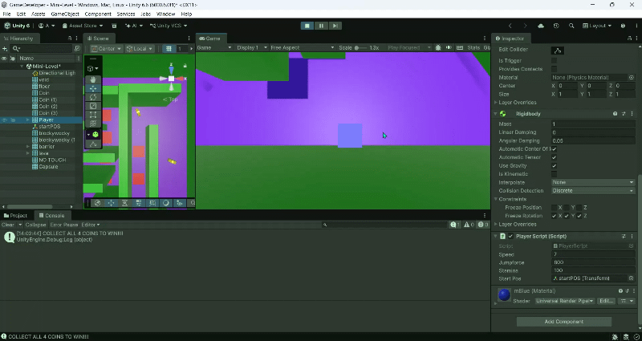
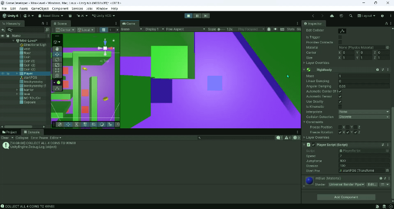

# MiniLevel
uitleg simulise bla

**Naam: Amaya** <!-- jouw naam -->  
**Klas: SD1A** <!-- jouw klas -->
**Datum: 3-11-2026** <!-- datum van inleveren -->  
**Les: 6.1** GDV Les 6

---

## Wat heb ik gemaakt?

Het doel van mijn level is dat je de 4 coins moet verzamelen en dan heb je gewonnen.
<!-- Beschrijf kort je mini-level. Wat moet de speler doen? Wat is het doel? -->

...

---

## Screenshot / GIF van je level

<!-- Voeg hieronder een screenshot of een GIF toe van je werkende level.
     Sleep het bestand naar deze map en gebruik dan de syntax hieronder. -->
Mijn excuses voor de slechte kwaliteit.



<!-- Tip: gebruik ShareX, LICEcap of de ingebouwde Xbox Game Bar (Win+G) om een GIF op te nemen. -->

---

## Bewegend object

de coins draaien rond.
de speler beweegt en moet springen.

<!-- Welk object beweegt en hoe heb je dat gedaan? -->

...

```csharp
// Plak hier het script of het stuk code dat het object laat bewegen.
void Update()
{
        float horizontal = Input.GetAxis("Horizontal"); // movement
        float vertical = Input.GetAxis("Vertical");

        Vector3 direction = new Vector3(horizontal, 0f, vertical);

        rb.linearVelocity = new Vector3(
            direction.x * speed,
            rb.linearVelocity.y,
            direction.z * speed
            );

        if (Input.GetKeyDown(KeyCode.Space) && stamina > 0)
        {
            jump();
            Debug.Log("Stamina: " + stamina);
        }
}
```
```csharp
    void jump() // movement
    {
        rb.AddForce(Vector3.up * jumpforce);
        stamina--;
    }
```
---

## Collider of trigger

<!-- Welk object heeft een collider of trigger, en wat gebeurt er? -->
de lava (rood) heeft die killzone.
capsule en coins hebben destroy. 
...

```csharp
// Plak hier de OnCollisionEnter/OnTriggerEnter code die je hebt gebruikt.
private void OnTriggerEnter(Collider other)
{
        if (other.CompareTag("Dangerzone"))
        {
            playerHealth -= 10;
            
            Debug.Log("Nope! Health: " + playerHealth);
            gameObject.transform.position = startPos.position;

            if (playerHealth <= 0)  
            {
                Debug.Log("...UH.OH....");
                Debug.Log("..YOU.DIED..");
                Debug.Log("..YOU.LOST..");
                Debug.Log(".THIS.LEVEL.");
            }

        }

        if (other.CompareTag("Coin")) // collect
        {
            coin++;
            Debug.Log("Collected Coin, total coins:  " + coin);
            Destroy(other.gameObject);
            
            if (coin == 4)
            {
                Debug.Log("..CONGRATULATIONS..");
                Debug.Log("...YOU.COLLECTED...");
                Debug.Log("....ALL.4.COINS....");
                Debug.Log(".YOU.WON.THIS.LEVEL.");
            }

        }

        if (other.CompareTag("Potion"))
        {
            playerHealth += 80;

            Debug.Log("You drank a Potion. Health: " + playerHealth);
            Destroy(other.gameObject);
            
            if (playerHealth >= 100)
            {
                playerHealth = 100;
            }
        }
}
```

---

## Logica met `if` of `switch`

<!-- Beschrijf kort welke keuze je hebt gemaakt (bijv. sleutel → deur open). -->

...

```csharp
// Plak hier het stuk code met jouw if- of switch-logica.
if ()
{
 // zie void-update & void-trigger :)
}
```

---

## Eigen extra idee

<!-- Wat is jouw eigen extra feature? Beschrijf wat het doet en hoe je het hebt gebouwd. -->

...

```csharp
// zie "Potion" in void-trigger
// Optioneel: plak hier de bijbehorende code.

```

---

## Evaluatie

### Wat ging goed? en waarom?

het was leuk om te maken en ging voor de rest wel goed.
<!-- Wat lukte je makkelijk of waar ben je trots op? -->

...

### Wat vond je lastig? en waarom?

niet dat ik weet.
<!-- Waar liep je tegenaan? Hoe heb je het opgelost (of niet)? -->

...

### Wat zou je een volgende keer anders doen?
misschien nog meer ideeen toevoegen? 
<!-- Wat heb je geleerd? -->